# Informe técnico: análisis de tráfico con Wireshark

## Objetivo y alcance

En esta práctica he seguido cuatro tutoriales de Wireshark de Unit 42 (el equipo de ciberseguridad de Palo Alto Networks): configurar las columnas, usar filtros de visualización, identificar hosts y usuarios, y exportar objetos de un pcap. En cada apartado explico lo que he hecho, lo que he aprendido y pongo las capturas que fui sacando (numeradas 2.x, 3.x y 4.x según el tutorial). Del primer tutorial no tengo capturas.

Los pcaps los descargué del [repositorio de GitHub de Unit 42](https://github.com/PaloAltoNetworks/Unit42-Wireshark-tutorials) y los analicé con Wireshark en una máquina virtual con Debian. Los tutoriales recomiendan no abrir este tráfico desde Windows porque lleva malware real. Para todas las prácticas usé el perfil de columnas "Customized" que creé en el tutorial 1.

## Tutorial 1: personalizar la visualización de columnas

Fuente: [Wireshark Tutorial: Changing Your Column Display](https://unit42.paloaltonetworks.com/unit42-customizing-wireshark-changing-column-display/). Pcap: Wireshark-tutorial-column-setup.pcap. De este no saqué capturas porque eran solo pasos de configuración y era bastante fácil. Igualmente, el resultado se ve en todas las capturas de los tutoriales 2 a 4: la hora en UTC, las columnas Dst port y Host, y el perfil "Customized" abajo a la derecha.

### Qué se hace

1. Copié el perfil por defecto en Edit > Configuration Profiles y lo llamé "Customized". Así, si me equivoco, el perfil original queda intacto.
2. Cambié el formato de la hora en View > Time Display Format a "UTC Date and Time of Day", con resolución de segundos.
3. Quité las columnas No., Protocol y Length, que para revisar tráfico web no aportan mucho.
4. En Column Preferences añadí Src port y Dst port (sin resolver) y puse Source y Destination también sin resolver, para ver IPs y no nombres.
5. Con "Apply as Column" creé una columna con el campo `http.host` y otra con `tls.handshake.extensions_server_name` (el SNI del Client Hello). Después las junté en una sola columna Host con el valor `http.host or tls.handshake.extensions_server_name`.
6. Oculté Src y Src port, porque cuando todo el tráfico sale del mismo equipo infectado no hace falta verlas.
7. Exporté el perfil como ZIP para poder cargarlo en otro ordenador sin repetir todo.

| Columna final | Contenido |
| --- | --- |
| Time | Fecha y hora en UTC |
| Src / Src port | IP y puerto de origen, sin resolver |
| Dst / Dst port | IP y puerto de destino, sin resolver |
| Host | Dominio de tráfico HTTP (cabecera Host) o HTTPS (SNI) |
| Info | Resumen del paquete |

### Qué he aprendido

Me he dado cuenta de que la vista por defecto de Wireshark sirve para cosas de red en general, pero para buscar una infección se queda corta. Lo que quiero ver rápido es cuándo pasa algo, a qué IP y puerto va y qué dominio se está contactando. La columna Host es la que más me ha servido, porque enseña el dominio incluso en HTTPS: el SNI va sin cifrar en el Client Hello, cosa que no sabía.

También he entendido por qué se usa UTC: si compartes lo que has encontrado con gente de otros países, todos hablan de la misma hora. Y tener un perfil propio que se puede exportar es muy práctico, porque la configuración no se pierde. Por último, hice caso de la recomendación de usar Linux para analizar los pcaps, ya que los ficheros que llevan dentro podrían infectar un Windows.

## Tutorial 2: expresiones de filtro de visualización

Fuente: [Wireshark Tutorial: Display Filter Expressions](https://unit42.paloaltonetworks.com/using-wireshark-display-filter-expressions/). Pcaps: Wireshark-tutorial-filter-expressions-1-of-5 a 5-of-5.

### Qué se hace

El filtro de visualización funciona con expresiones booleanas (`eq`, `and`, `or`, `!`). Si la barra se pone verde, la expresión está bien; si se pone roja, hay algún error. En este tutorial creé tres botones de filtro al lado de la barra, que se guardan en el perfil y se aplican con un clic:

| Botón | Expresión | Qué añade |
| --- | --- | --- |
| basic | `(http.request or tls.handshake.type eq 1) and !(ssdp)` | Peticiones HTTP y dominios HTTPS, sin el ruido de SSDP |
| basic+ | `(http.request or tls.handshake.type eq 1 or (tcp.flags.syn eq 1 and tcp.flags.ack eq 0)) and !(ssdp)` | Inicio de toda conexión TCP (SYN sin ACK), también la no web y la fallida |
| basic+dns | `(http.request or tls.handshake.type eq 1 or (tcp.flags.syn eq 1 and tcp.flags.ack eq 0) or dns) and !(ssdp)` | Consultas DNS, para asociar cada IP a un dominio |

Con estos filtros revisé cinco pcaps: tráfico C2 de Loki Bot por HTTP, dominios de IcedID, una RAT que no usa tráfico web, robo de datos por FTP y un spambot por SMTP. Las capturas que saqué son de los pcaps 3, 4 y 5.

### Pcap 3: RAT con tráfico no web

Con el filtro basic no vi nada raro. Al poner basic+dns apareció una consulta DNS a `adaisreal.ddns.net` y justo después un SYN al puerto TCP 7888 de la IP que devuelve. Es el canal de mando y control (C2) de Ave Maria RAT, también llamada Warzone RAT. Un dominio de DNS dinámico conectando a un puerto poco habitual es bastante sospechoso.

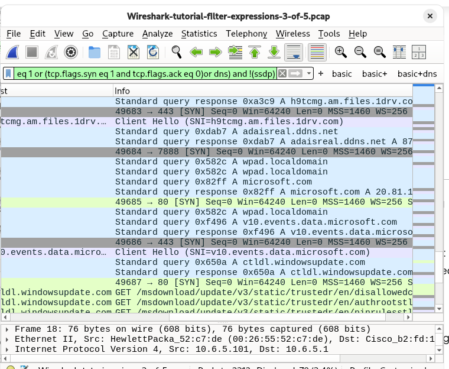

*Captura 2.3. Filtro basic+dns en el pcap 3: consulta a adaisreal.ddns.net y SYN al puerto 7888.*

### Pcap 4: exfiltración de datos por FTP

Con basic+dns se ve una conexión HTTPS a `api.ipify.org`, un servicio legal que el malware usa para saber la IP pública de la víctima. Justo después hay conexiones a 190.107.177.239 por el puerto 21 (FTP) y por un puerto alto (el canal de datos).

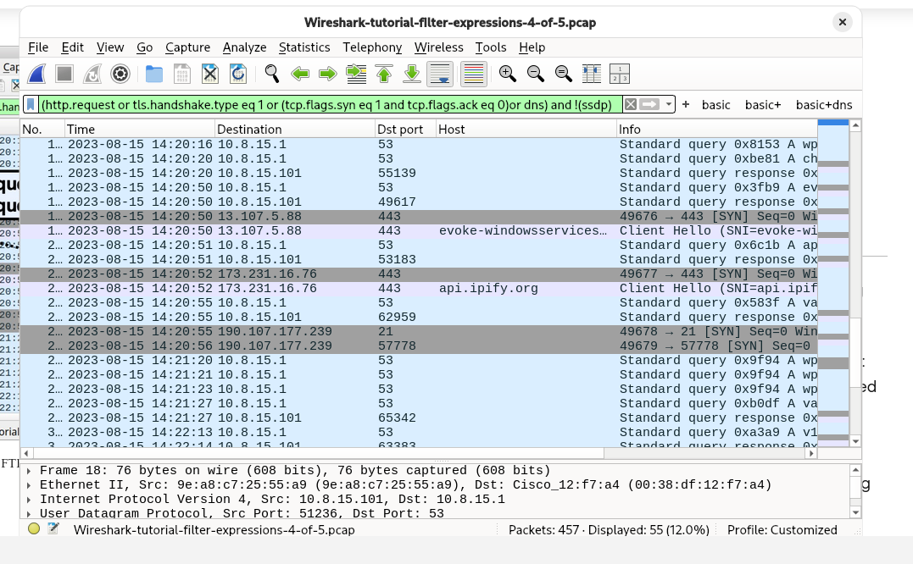

*Captura 2.4. Filtro basic+dns en el pcap 4: api.ipify.org seguido de tráfico FTP a 190.107.177.239.*

Con el filtro `ftp.request.command or (ftp-data and tcp.seq eq 1)` se ve toda la sesión FTP: el usuario y la contraseña en texto plano (USER y PASS), el modo pasivo (PASV) y un STOR que sube un fichero que empieza por `PW_user1-DESKTOP`. Es decir, el malware está mandando las contraseñas robadas del equipo a un servidor FTP comprometido.

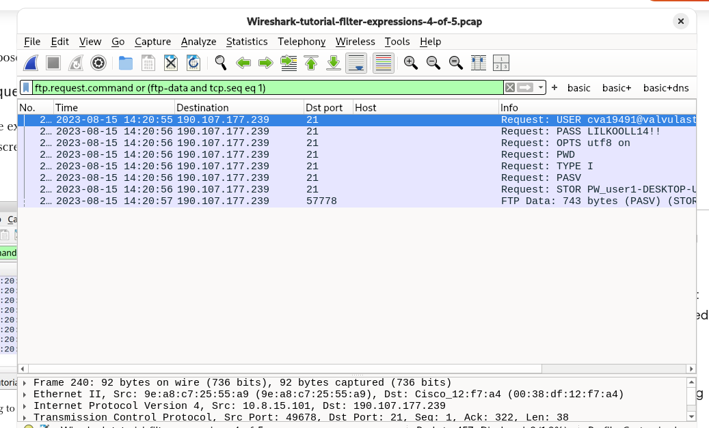

*Captura 2.4.1. Filtro FTP: comandos USER, PASS, STOR y el primer segmento del canal de datos (743 bytes).*

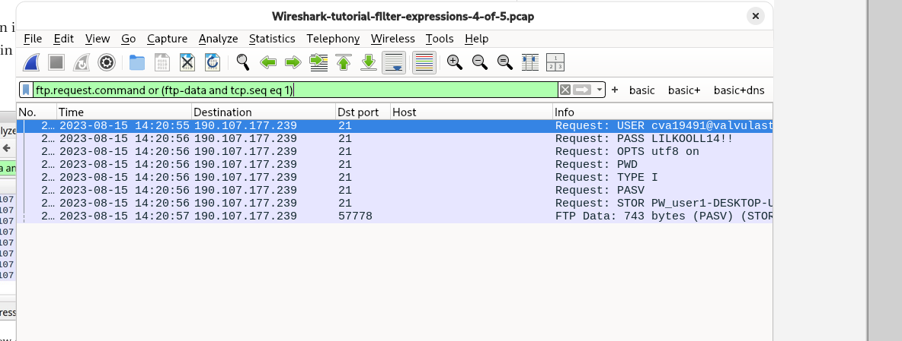

*Captura 2.4.2. Mismo filtro, vista completa de la secuencia de comandos FTP.*

### Pcap 5: tráfico de spambot

Un spambot hace muchas consultas DNS a servidores de correo y luego conecta por SMTP (puertos 25, 465 o 587). Con el filtro `smtp or dns` se ve ese patrón.

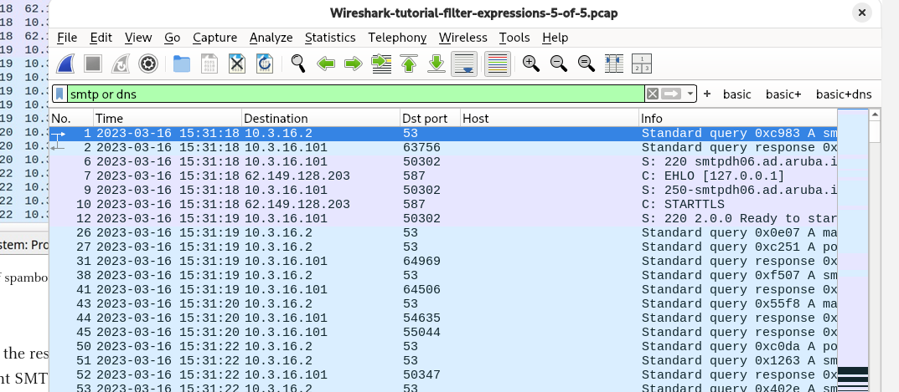

*Captura 2.5. Filtro smtp or dns en el pcap 5: consultas DNS a servidores de correo y diálogo SMTP.*

Con `smtp.req.command` se ve que el equipo habla con muchos servidores distintos en pocos segundos. Casi siempre manda EHLO y después STARTTLS, así que la mayoría del correo va cifrado.

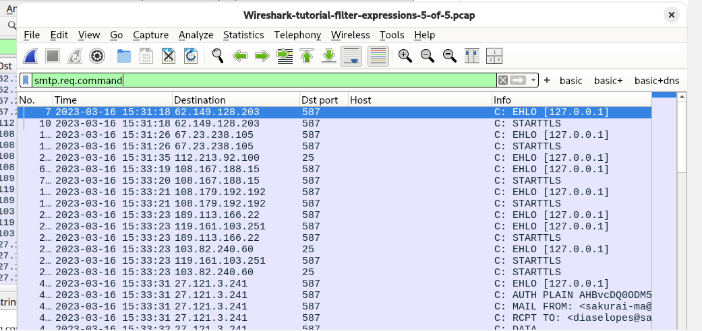

*Captura 2.5.1. Filtro smtp.req.command: EHLO y STARTTLS contra varios servidores, y una sesión sin cifrar con AUTH PLAIN, MAIL FROM y RCPT TO.*

Los mensajes que no usan STARTTLS se encuentran con `smtp.data.fragment` y se pueden leer con Follow > TCP Stream. En la sesión que abrí se ve la autenticación (AUTH PLAIN, que va en Base64 y se decodifica sin problema), el remitente y el destinatario.

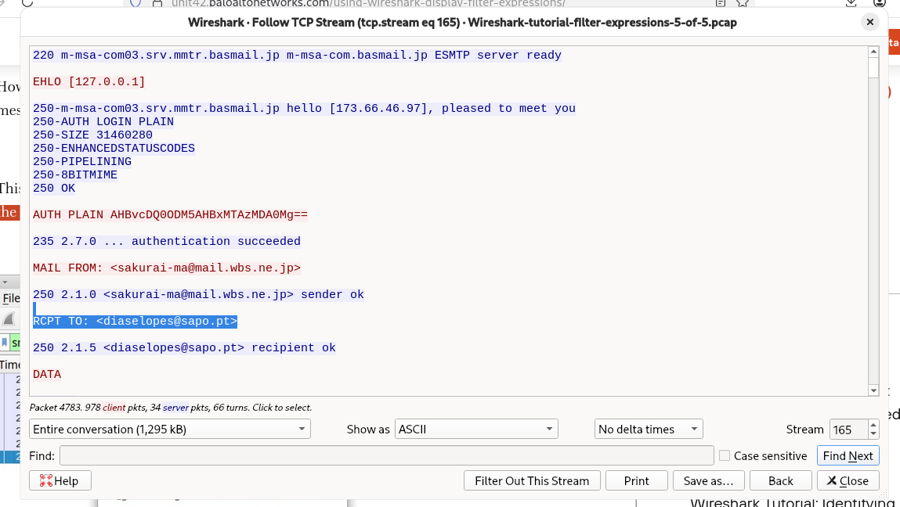

*Captura 2.5.2. Follow TCP Stream (stream 165): sesión SMTP sin cifrar con autenticación, MAIL FROM y RCPT TO.*

### Qué he aprendido

Lo más importante que me llevo es ir paso a paso: primero basic para el tráfico web, luego basic+ para ver conexiones que no son web o que fallan, y al final basic+dns para saber a qué dominio pertenece cada IP. En el pcap 3 lo vi muy claro: con basic no encontré nada y con basic+dns salió el C2 de la RAT en el puerto 7888. También me ha sorprendido lo fácil que es ver contraseñas y datos robados cuando se usa FTP o SMTP sin cifrar. Y guardar los filtros como botones me ha ahorrado mucho tiempo y errores al escribirlos.

## Tutorial 3: identificar hosts y usuarios

Fuente: [Wireshark Tutorial: Identifying Hosts and Users](https://unit42.paloaltonetworks.com/using-wireshark-identifying-hosts-and-users/). Pcaps: Wireshark-tutorial-identifying-hosts-and-users-1-of-5 a 5-of-5.

Cuando salta una alerta, lo primero es saber qué equipo está infectado y quién lo usa. Cada equipo tiene tres identificadores (MAC, IP y nombre de host), y en este tutorial vi qué protocolos los muestran. Esto es lo que saqué de cada pcap:

| Pcap | IP | Identificación | Protocolo usado |
| --- | --- | --- | --- |
| 1 | 172.16.1.38 | jeremiahs-MBP, MAC f8:ff:c2:04:a5:7b (Apple) | DHCP, NBNS |
| 2 | 172.16.1.101 | DESKTOP-HVKYP4S, MAC 78:c2:3b:b8:93:e8 | NBNS |
| 3 | 172.16.1.141 | DESKTOP-HSJD5R8, Windows 10/11 con Edge 110, usuario rene.mccollum (Rene McCollum) | HTTP User-Agent, Kerberos, LDAP |
| 4 | 172.16.1.62 | Google Pixel 4a (5G), Android 13, Chrome 113 | HTTP User-Agent |
| 5 | 172.16.1.35 | iPhone con iOS 16.4.1, Safari | HTTP User-Agent |

### Nombre de host por DHCP

Con el filtro `dhcp` salen el DHCP Request y el ACK. En el detalle del Request, la opción 50 es la IP que pide el equipo y la opción 12 es su nombre. La MAC la resuelve Wireshark como Apple y el nombre acaba en MBP, así que seguramente es un MacBook Pro. Aun así, no me fiaría solo de la MAC, porque los móviles la cambian y se puede falsificar.

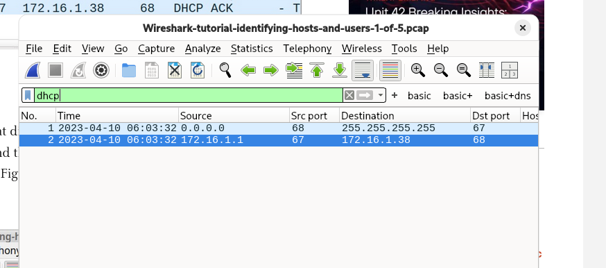

*Captura 3. Filtro dhcp en el pcap 1: DHCP Request desde 0.0.0.0 y respuesta del servidor 172.16.1.1.*

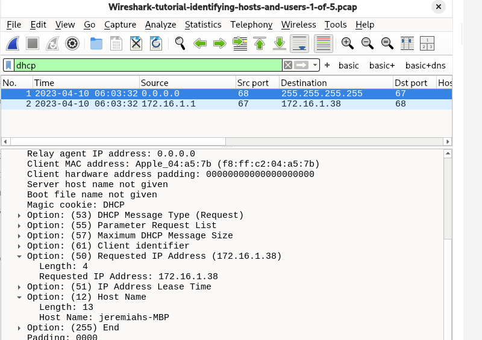

*Captura 3.1. Detalle del DHCP Request: MAC f8:ff:c2:04:a5:7b, IP solicitada 172.16.1.38 y Host Name jeremiahs-MBP.*

### Nombre de host por NBNS

Si durante la captura no se renueva la IP, no habrá tráfico DHCP. En ese caso sirve NBNS (NetBIOS Name Service, puerto UDP 137), que usan Windows y macOS: en los registros de nombre aparece el nombre del equipo y su IP.

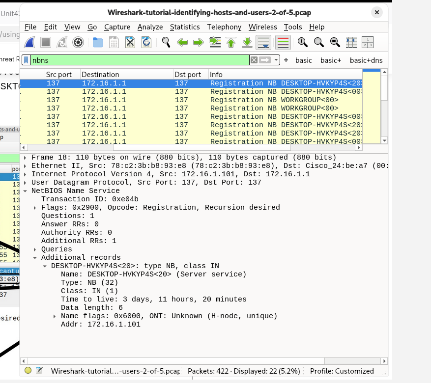

*Captura 3.2. Filtro nbns en el pcap 2: registro de DESKTOP-HVKYP4S con IP 172.16.1.101.*

### Sistema operativo y dispositivo por el User-Agent

En el tráfico HTTP sin cifrar, la cabecera User-Agent dice qué sistema operativo y qué navegador se usan. Con el filtro `http.accept_language` me quedé solo con las peticiones de un navegador, y con Follow > TCP Stream vi las cabeceras completas. "Windows NT 10.0" quiere decir Windows 10 u 11, y "Edg/" es Microsoft Edge.

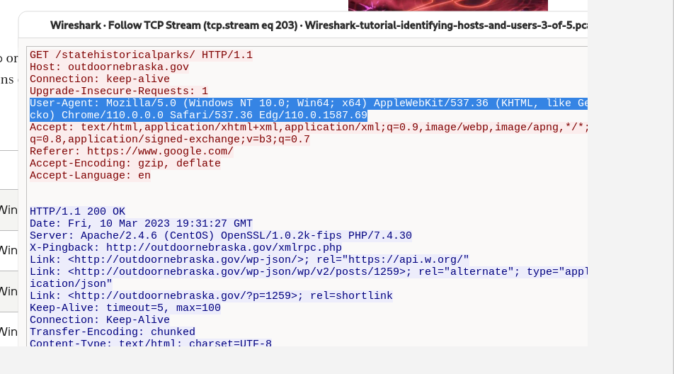

*Captura 3.3. Follow TCP Stream en el pcap 3: User-Agent de Edge 110 sobre Windows NT 10.0.*

En Android el User-Agent puede llevar hasta la marca y el modelo del móvil, y en iPhone la versión de iOS.

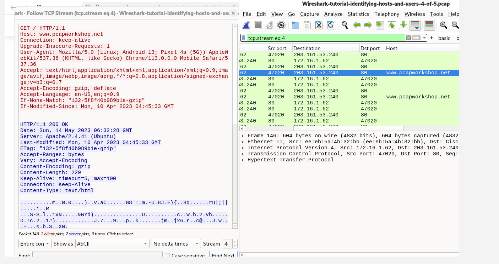

*Captura 3.4. Pcap 4, tcp.stream eq 4: User-Agent de Chrome en Android 13, Pixel 4a (5G).*

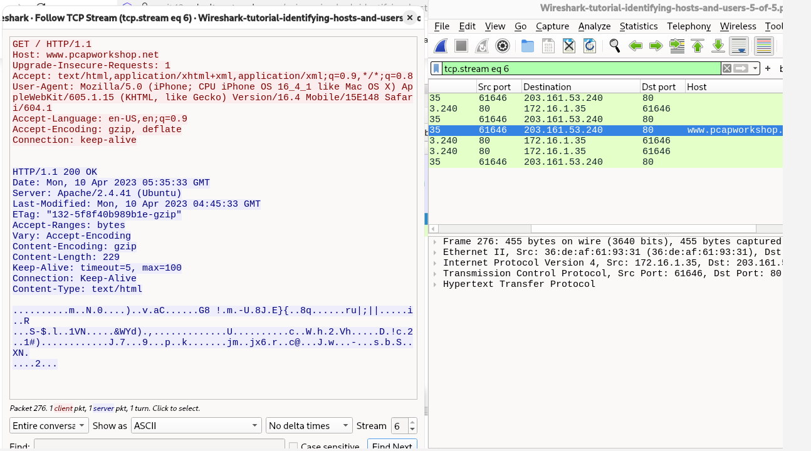

*Captura 3.5. Pcap 5, tcp.stream eq 6: User-Agent de Safari en iPhone, iOS 16.4.1.*

Eso sí, este método cada vez funciona peor: el User-Agent se puede falsificar (el malware lo hace mucho), los navegadores ya no dicen la versión real del sistema y casi todo el tráfico web va ya por HTTPS.

### Usuario en un entorno Active Directory

En un dominio de Windows, el usuario aparece en el tráfico Kerberos. Filtré por `kerberos.CNameString` y con "Apply as Column" añadí el campo CNameString como columna. Así se ven las cuentas que se autentican: primero la del equipo (desktop-hsjd5r8$) y después la del usuario (rene.mccollum), contra el controlador de dominio 172.16.1.16 del dominio pcapworkshop.net.

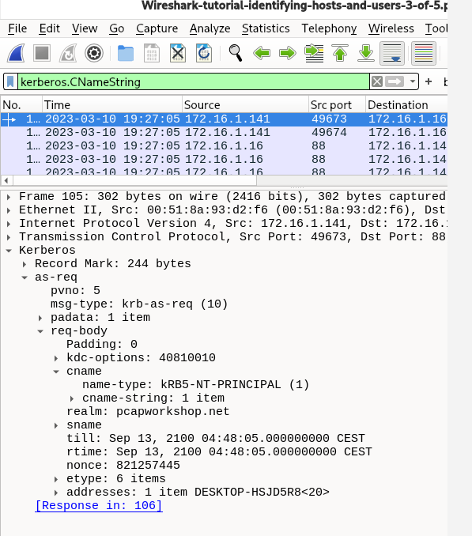

*Captura 3.6. Filtro kerberos.CNameString en el pcap 3: AS-REQ desde 172.16.1.141 al controlador de dominio, realm pcapworkshop.net.*

Con el filtro `ldap contains "CN=Users"` busqué en las consultas LDAP y salió el nombre completo del usuario: Rene McCollum.

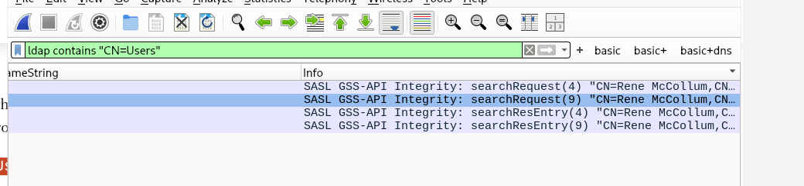

*Captura 3.7. Filtro ldap contains "CN=Users": búsquedas LDAP con CN=Rene McCollum.*

### Qué he aprendido

Lo que más me ha gustado de este tutorial es ver que, juntando información de varios protocolos (DHCP, NBNS, HTTP, Kerberos y LDAP), puedes pasar de una simple IP a un equipo y a una persona. En el pcap 3 pasé de 172.16.1.141 a DESKTOP-HSJD5R8 y a Rene McCollum. Esto es justo lo que hace falta para aislar el equipo y avisar al usuario. También aprendí que los nombres por defecto de Windows 10 y 11 empiezan por "DESKTOP-", y que se pueden buscar con `ip contains "DESKTOP-"` o con Edit > Find Packet.

## Tutorial 4: exportar objetos de un pcap

Fuente: [Wireshark Tutorial: Exporting Objects From a Pcap](https://unit42.paloaltonetworks.com/using-wireshark-exporting-objects-from-a-pcap/). Pcaps: Wireshark-tutorial-extracting-objects-from-a-pcap-1-of-5 a 5-of-5.

Wireshark junta los segmentos TCP y puede reconstruir los ficheros que se han enviado por protocolos sin cifrar. Para sacarlos se usa File > Export Objects y se elige el protocolo (HTTP, SMB, IMF o FTP-DATA). Después comprobé cada fichero fuera de Wireshark con `file` (para ver qué tipo de fichero es de verdad) y `shasum -a 256` (para sacar el hash), y busqué el hash en VirusTotal. Estos son los objetos que saqué:

| Pcap | Protocolo | Objeto | Tipo confirmado | SHA256 |
| --- | --- | --- | --- | --- |
| 1 | HTTP | Invoice&MSO-Request.doc | Documento Word (Composite Document File V2) | f808229aa516ba134889f81cd699b8d246d46d796b55e13bee87435889a054fb |
| 1 | HTTP | knr.exe | Ejecutable PE32 de Windows | 749e161661290e8a2d190b1a66469744127bc25bf46e5d0c6f2e835f4b92db18 |
| 2 | HTTP | Página de login falsa de PayPal | HTML | |
| 4 | SMTP (IMF) | 50 correos .eml de sextorsión | Texto (Internet Message Format) | |
| 5 | FTP-DATA | Logs HTML con credenciales robadas | HTML | |
| 5 | FTP (TCP stream) | q.exe | Ejecutable PE32 de Windows, 58/71 detecciones en VirusTotal | ca34b0926cdc3242bbfad1c4a0b42cc2750d90db9a272d92cfb6cb7034d2a3bd |

El pcap 3 (Trickbot propagándose por SMB) lo hice siguiendo el tutorial, pero no saqué capturas.

### HTTP: malware descargado y página de phishing

En el pcap 1, con el filtro `http.request` se ven dos GET a smart-fax.com: uno pide un .doc y otro un .exe. Los exporté desde File > Export Objects > HTTP. La columna Content Type enseña lo que dice el servidor, pero el servidor puede mentir, por eso comprobé el tipo real con `file`.

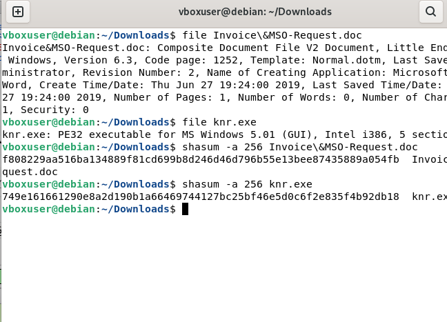

*Captura 4. Terminal en Debian: file y shasum -a 256 sobre Invoice&MSO-Request.doc y knr.exe.*

En el pcap 2 exporté la página HTML de un phishing y la abrí en el navegador para ver lo que vio la víctima. Esto hay que hacerlo en un entorno aislado, porque el HTML puede cargar cosas de dominios maliciosos.

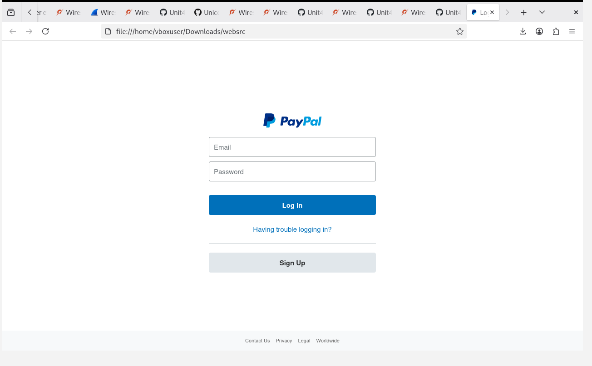

*Captura 4.1. Página de login falsa de PayPal exportada del pcap 2 y abierta en local.*

### SMTP: correos de un spambot

En el pcap 4 hay un equipo infectado mandando spam de sextorsión. Con el filtro `smtp.data.fragment` se ven los mensajes enviados sin cifrar, todos desde 10.6.1.104 y en muy pocos segundos.

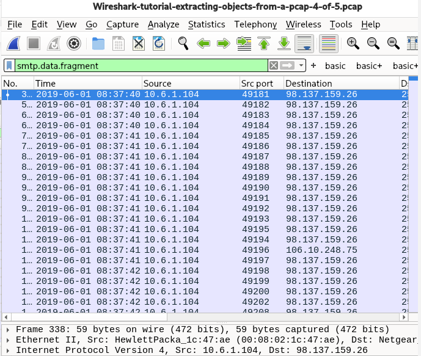

*Captura 4.2. Filtro smtp.data.fragment en el pcap 4: envíos SMTP desde 10.6.1.104.*

Con File > Export Objects > IMF salen los correos como ficheros .eml, con el remitente y el asunto. Se pueden guardar todos de golpe y abrirlos con un editor de texto.

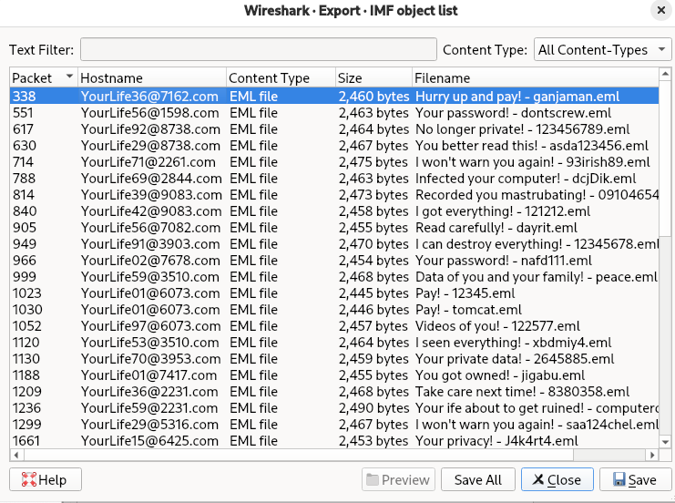

*Captura 4.3. Lista de objetos IMF: correos .eml de unos 2.460 bytes con asuntos de extorsión.*

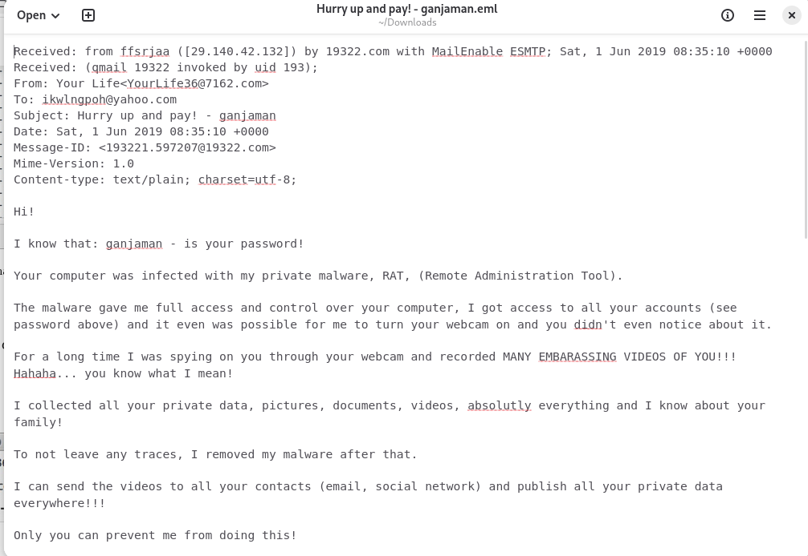

*Captura 4.4. Contenido de "Hurry up and pay! - ganjaman.eml": cabeceras y texto de la extorsión.*

### FTP: descarga de malware y exfiltración

En el pcap 5, con el filtro `ftp.request.command or (ftp-data and tcp.seq eq 1)` se ve el login en el servidor FTP, varios RETR (descargas de q.exe, w.exe, e.exe, r.exe y t.exe) y comandos STOR que suben ficheros HTML más o menos cada 18 segundos.

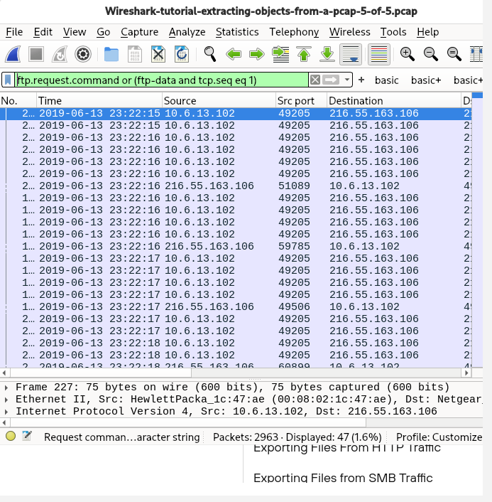

*Captura 4.5. Filtro FTP en el pcap 5: sesión entre 10.6.13.102 y 216.55.163.106.*

Con File > Export Objects > FTP-DATA saqué los HTML que se subían. Dentro hay credenciales robadas del correo y del navegador de la víctima: cuentas de Outlook, POP3, SMTP y hasta una de banca online.

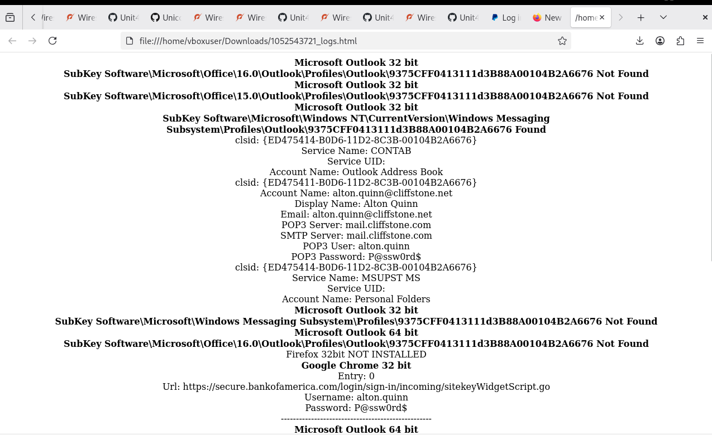

*Captura 4.6. Log HTML exportado: credenciales de correo y navegador robadas del host infectado.*

Los .exe no salen en FTP-DATA, así que hay que sacarlos a mano. Los busqué con `ftp-data.command contains ".exe" and tcp.seq eq 1`, abrí Follow > TCP Stream, cambié la vista a Raw y lo guardé con "Save as". El flujo empieza por "MZ" y tiene el texto "This program cannot be run in DOS mode", que es lo típico al principio de un ejecutable de Windows.

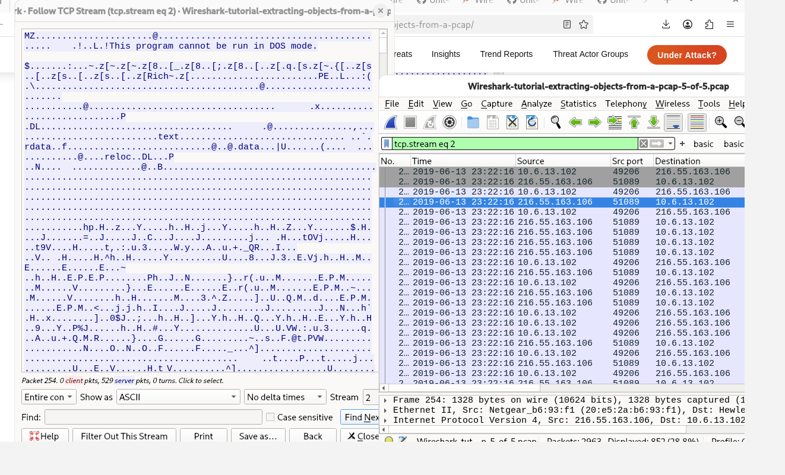

*Captura 4.7. Follow TCP Stream (stream 2): cabecera MZ del ejecutable q.exe en el canal de datos FTP.*

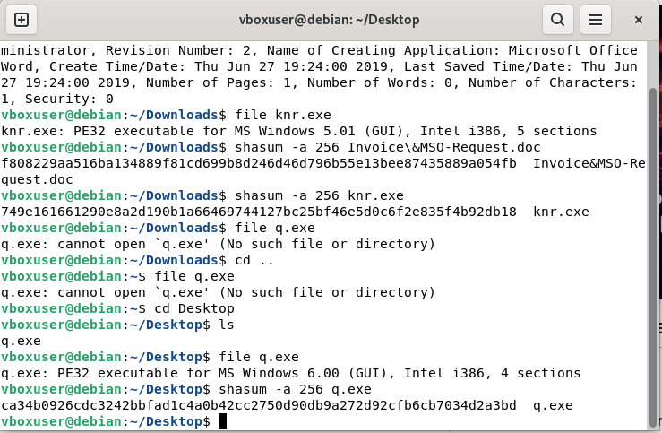

*Captura 4.8. file y shasum -a 256 sobre q.exe: ejecutable PE32 de Windows.*

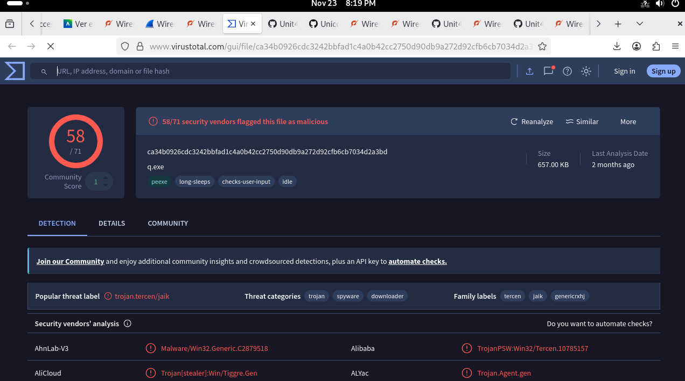

*Captura 4.9. VirusTotal: 58 de 71 motores detectan q.exe como malicioso (troyano, spyware, downloader).*

### Qué he aprendido

Este ha sido el tutorial que más me ha impresionado. No pensaba que en un pcap estuviera todo: el malware, el phishing, el spam y hasta los datos robados. Al exportarlos pude sacar los hashes, que sirven como indicadores de compromiso para compartirlos o buscarlos en otros equipos, y ver el daño real, por ejemplo qué contraseñas habría que cambiar. En SMB hay que fijarse en que el objeto esté al 100%, porque si no el fichero sale incompleto. Y como lo que exporté era malware de verdad, lo hice todo dentro de la máquina virtual Debian y sin ejecutar nada.

## Qué he aprendido y aspectos más importantes

Haciendo los cuatro tutoriales seguidos me he dado cuenta de que en realidad son un método completo para analizar un incidente. Primero preparo Wireshark (columnas y perfil), luego busco la actividad sospechosa con filtros, después identifico qué equipo y qué usuario están afectados, y al final saco las pruebas (ficheros, correos, contraseñas) para tener indicadores de compromiso.

Lo que para mí es más importante tener en cuenta:

1. **Trabajar en un entorno seguro.** Los pcaps llevan malware de verdad. Yo los analicé en una máquina virtual con Debian y no ejecuté nunca nada de lo que exporté. Las páginas HTML también pueden conectarse a dominios maliciosos al abrirlas, así que solo las abrí dentro de la máquina virtual.
2. **Tener las columnas bien configuradas.** Hora en UTC, puertos de origen y destino y la columna Host con `http.host` y el SNI de TLS. Sin la columna Host, en el tráfico HTTPS solo habría visto IPs.
3. **Filtrar paso a paso.** basic, basic+ y basic+dns. No todo es tráfico web: el C2 de la RAT iba por el puerto 7888 (captura 2.3) y solo lo encontré con el filtro de SYN. El DNS me ayudó a saber a qué dominio iba cada IP.
4. **Cruzar datos de varios protocolos.** La IP, la MAC, el nombre del equipo y el usuario los saqué de protocolos distintos (DHCP, NBNS, Kerberos, LDAP). La MAC y el User-Agent se pueden falsificar, así que no me fiaría solo de ellos.
5. **Lo que va sin cifrar se ve todo.** En FTP y SMTP sin TLS vi usuarios, contraseñas, correos y ficheros enteros (capturas 2.4.1, 2.5.2 y 4.6). Como administrador de sistemas, esto me deja claro que hay que obligar a usar protocolos cifrados.
6. **Comprobar lo que se exporta.** La extensión o el Content-Type pueden engañar. Con `file` vi el tipo real y con `shasum -a 256` saqué el hash, que busqué en VirusTotal (q.exe: 58 de 71 antivirus lo detectan) y que se puede compartir como IOC.
7. **Saber hasta dónde se puede llegar.** Con HTTPS no se ven las cabeceras ni el contenido, solo el dominio gracias al SNI. Si pude exportar ficheros o leer el User-Agent fue porque el tráfico iba en claro. Para HTTPS harían falta las claves para descifrarlo, que es justo lo que explica el siguiente tutorial de la serie.

## Fuentes

- [Wireshark Tutorial: Changing Your Column Display](https://unit42.paloaltonetworks.com/unit42-customizing-wireshark-changing-column-display/), Unit 42
- [Wireshark Tutorial: Display Filter Expressions](https://unit42.paloaltonetworks.com/using-wireshark-display-filter-expressions/), Unit 42
- [Wireshark Tutorial: Identifying Hosts and Users](https://unit42.paloaltonetworks.com/using-wireshark-identifying-hosts-and-users/), Unit 42
- [Wireshark Tutorial: Exporting Objects From a Pcap](https://unit42.paloaltonetworks.com/using-wireshark-exporting-objects-from-a-pcap/), Unit 42
